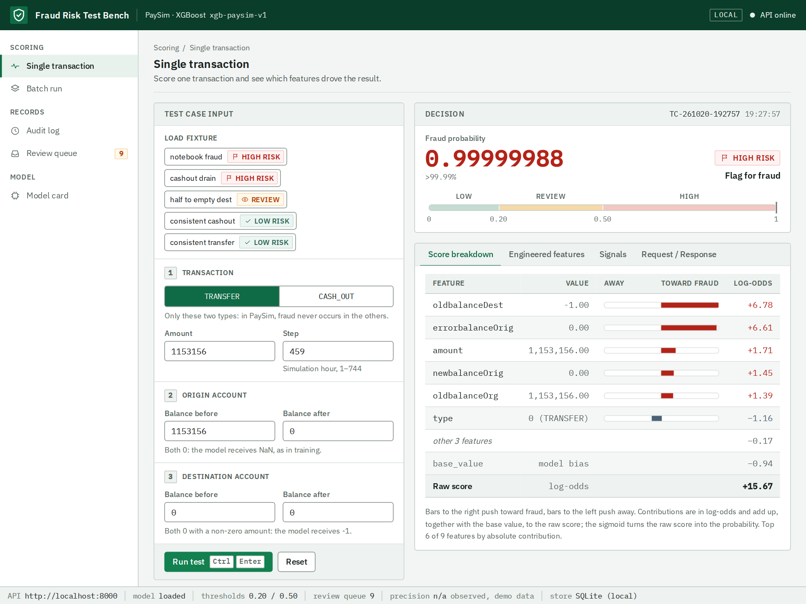
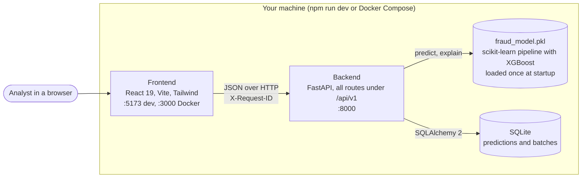
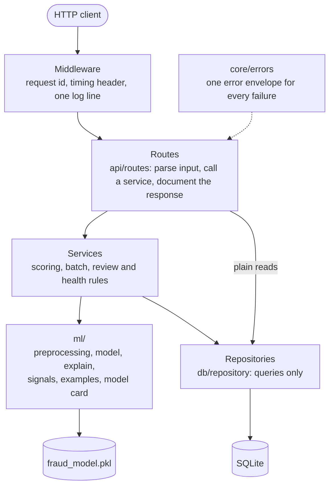
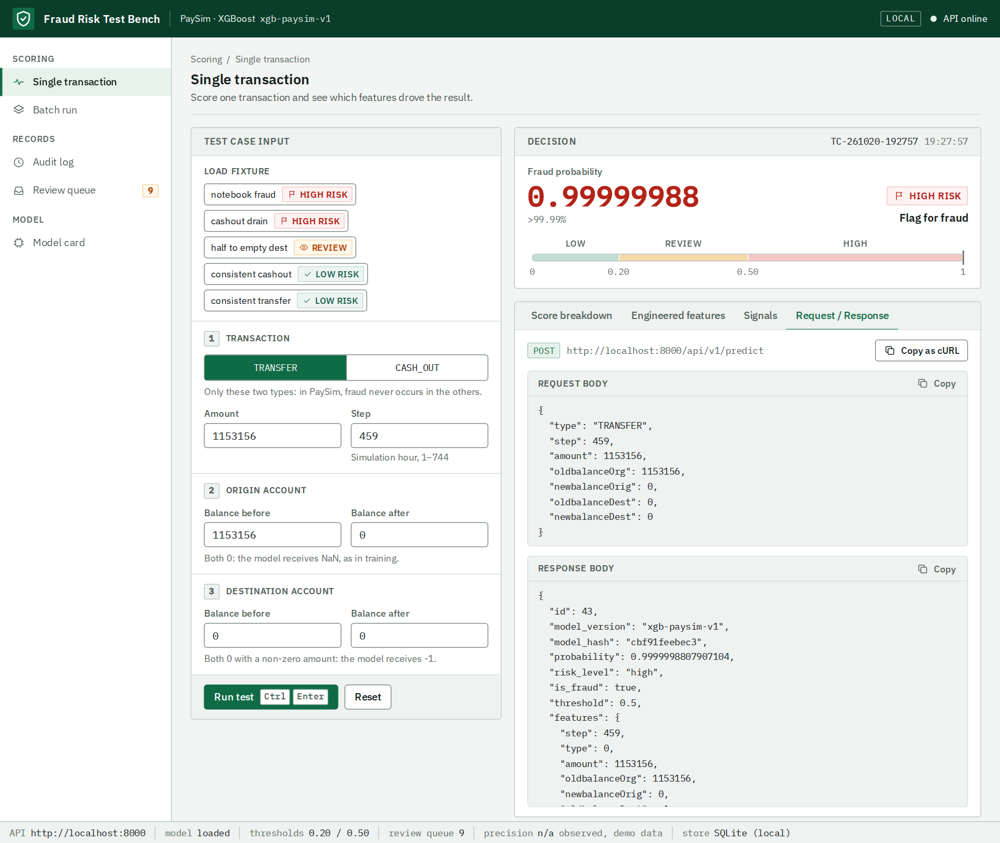
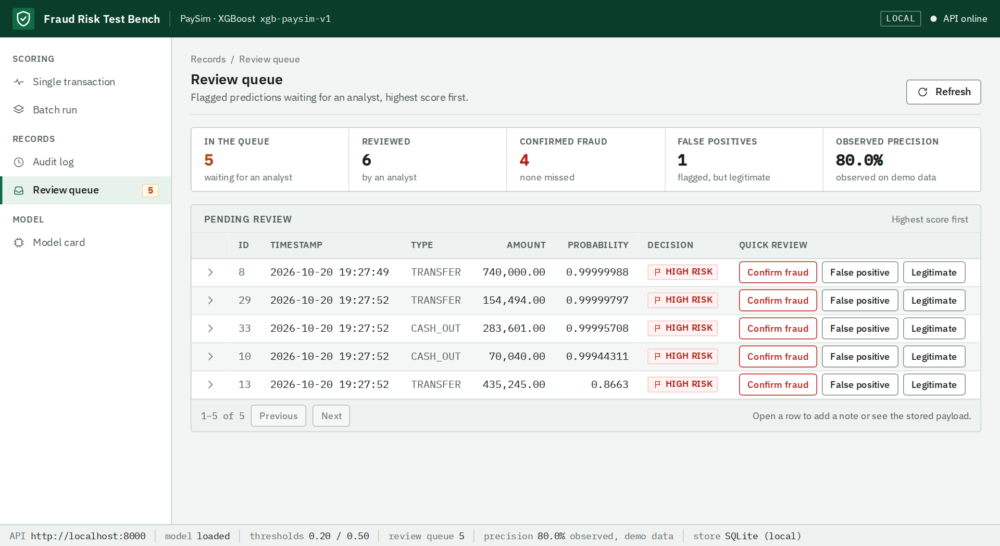
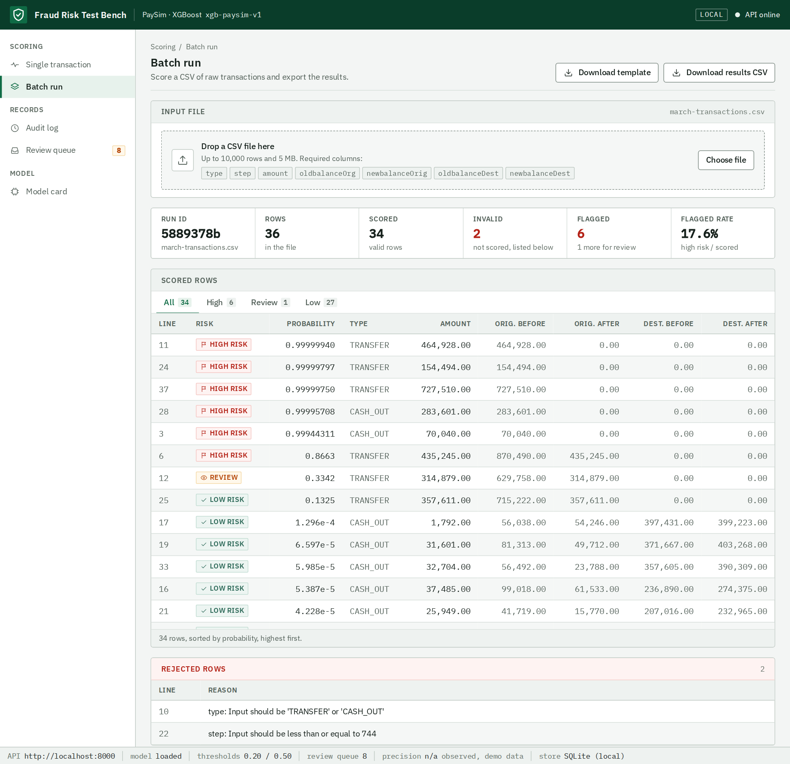
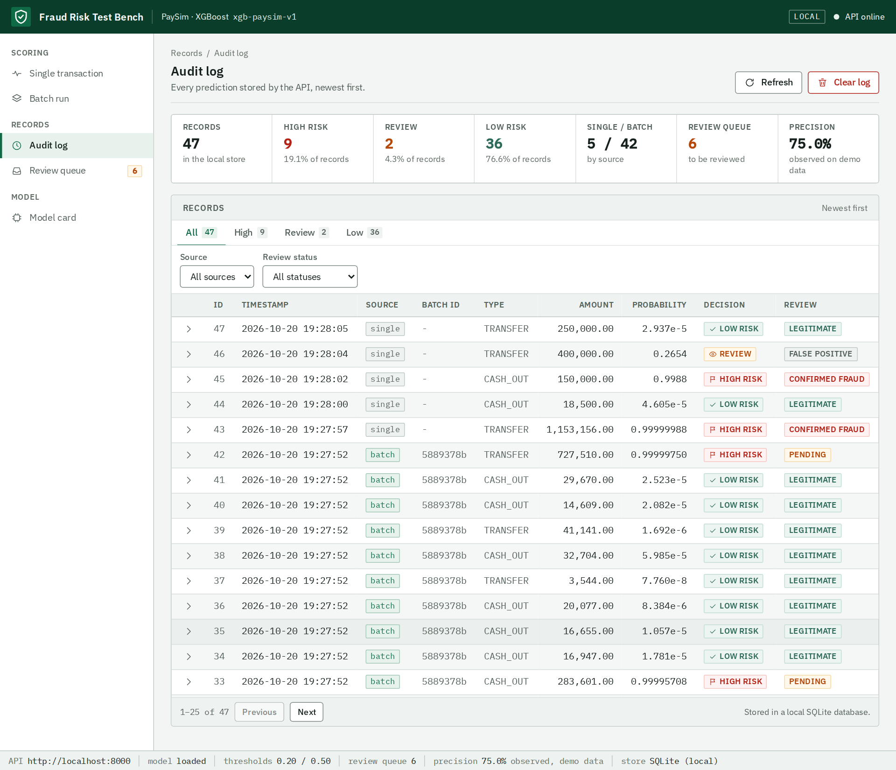
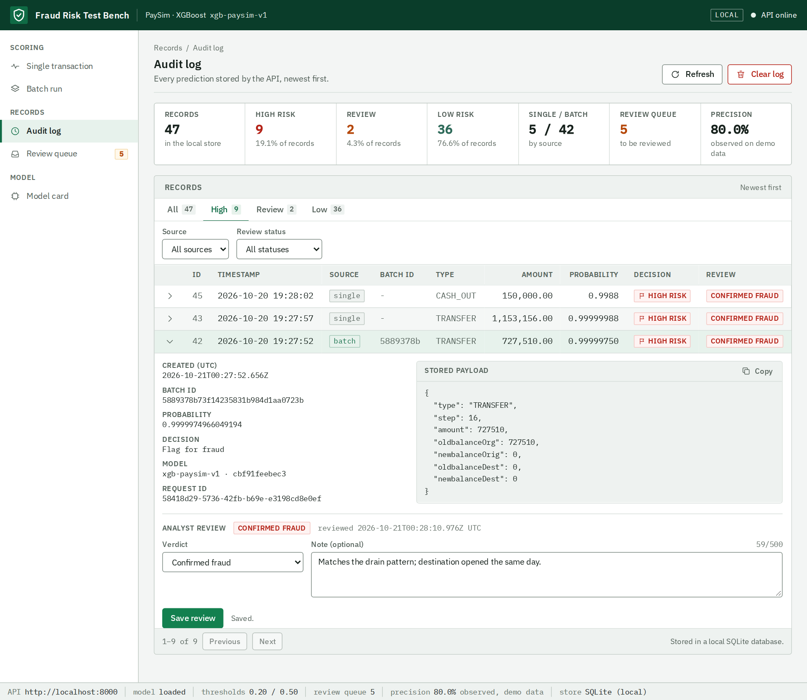
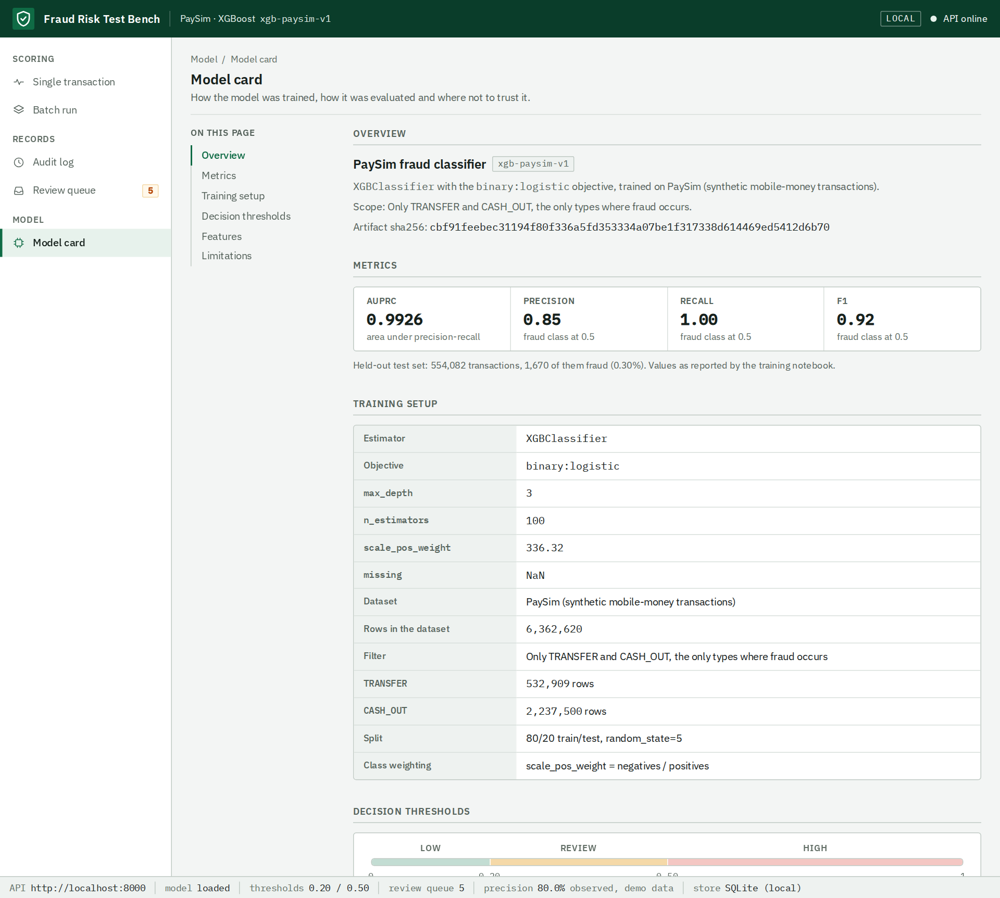
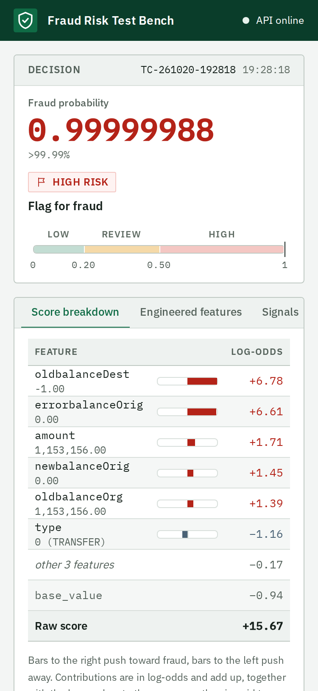

# Fraud Detection: XGBoost, FastAPI and a React console

[](https://github.com/Rerzd/fraud_detection_xgboost/actions/workflows/ci.yml)
[](LICENSE)

A fraud scoring service and a small analyst console, built around an XGBoost classifier trained on
[PaySim](https://www.kaggle.com/datasets/ealaxi/paysim1), a public synthetic mobile-money dataset. Send a raw transaction and the
API returns a fraud probability, a risk level (`low`, `review`, `high`), the contribution of each
feature to the score, and stores the result. The console lets you try single transactions, score
CSV files, browse the audit log and record an analyst's verdict on every flagged prediction.

This is a portfolio project. The data is synthetic, there is no authentication, and the numbers
describe a notebook experiment, not production performance (see [Limitations](#limitations)).

<p align="center">
  
</p>

## Contents

- [What it does](#what-it-does)
- [Quickstart](#quickstart)
- [Architecture](#architecture)
- [API v1](#api-v1)
- [Preprocessing](#preprocessing)
- [Model card](#model-card)
- [Explainability](#explainability)
- [Persistence](#persistence)
- [Review workflow](#review-workflow)
- [Configuration](#configuration)
- [The console](#the-console)
- [Testing and CI](#testing-and-ci)
- [Project structure](#project-structure)
- [Limitations](#limitations)
- [Deliberately out of scope](#deliberately-out-of-scope)
- [License](#license)

## What it does

- **Scores one transaction** from its six raw fields. The API reproduces the training notebook's
  preprocessing, so callers never compute derived features themselves.
- **Explains each score** with per-feature contributions in log-odds, which add up to the model's
  raw output, plus plain rule-based observations about the input.
- **Scores CSV files** of up to 10,000 rows and 5 MB, reporting invalid rows by line number instead
  of failing the whole file.
- **Keeps an audit log** in SQLite: every prediction with its request, the model that produced it
  and the request that created it. The log is paginated and filterable.
- **Supports analyst review**: flagged predictions wait in a queue, an analyst records a verdict,
  and the API reports the precision observed on those verdicts.
- **Is traceable**: every response and every stored row carries the model version and the short
  sha256 of the model file; every request has an id that appears in the response, the logs and the
  stored record.

## Quickstart

You need **Node 22** and **Python 3.11 or newer** (the Docker image and CI use 3.13).

```bash
npm run setup     # creates backend/.venv, installs the pinned requirements, runs npm ci in frontend/
npm run dev       # API on http://localhost:8000, console on http://localhost:5173
```

The interactive API documentation is at <http://localhost:8000/docs>. The scripts run on Linux,
macOS and Windows; they find the virtualenv's Python for you.

Other commands, all from the repository root:

| Command | What it does |
|---|---|
| `npm test` | Backend tests (pytest), then frontend tests (Vitest) |
| `npm run test:cov` | Backend tests with line coverage and the 100% gate |
| `npm run lint` | ESLint on the frontend |
| `npm run lint:py` | `ruff check` and `ruff format --check` on the backend |
| `npm run format:py` | Sort imports and format the backend with ruff |
| `npm run build` | Production build of the frontend |

### With Docker

```bash
docker compose up --build
```

The console is on <http://localhost:3000> and the API on <http://localhost:8000>. The backend
container is healthy only when `/api/v1/ready` answers 200 (model loaded and database responding),
and the frontend waits for it. The SQLite file lives in the `backend-data` volume, so the log
survives restarts.

**Image size.** The backend image is large: `docker images` reports about **1.9 GB**. That figure
is Docker's disk usage, which counts the unpacked layers (about 1.2 GB) and the compressed copies
it keeps (about 650 MB); a registry pull would be the compressed size. Nearly all of it is Python
packages. On Linux x86_64 the `xgboost` 3.2.0 wheel depends on NVIDIA's NCCL library (about
470 MB installed) and ships a GPU-enabled `libxgboost.so` (about 235 MB), although this project
only uses the CPU. scipy, pandas, scikit-learn and numpy add about 330 MB. The frontend image is
about 100 MB (static files behind nginx).

## Architecture

The system is two processes and two files: a browser app, a FastAPI service, the model artifact
and a SQLite database.



Inside the backend, each layer has one job and depends only on the layers below it.



- **Routes** stay thin: validate with Pydantic, call one service, return the result.
- **Services** hold the rules (what to score, how a batch is split, what a review may say).
- **Repositories** hold the SQL and nothing else. Simple listings go from a route straight to a
  repository, because a service in between would add nothing.
- **`ml/`** is pure: no HTTP, no database. It turns raw input into features, scores them and
  explains the score.
- **Dependencies** (settings, database session, loaded model) are injected with FastAPI `Depends`,
  so tests replace them without patching.

## API v1

Every endpoint lives under `/api/v1`. A breaking change would be published as `/api/v2`. The
OpenAPI document and Swagger UI are at `/openapi.json` and `/docs`.

| Method | Path | Purpose |
|---|---|---|
| GET | `/api/v1/health` | Liveness: the process is up; model version and short hash |
| GET | `/api/v1/ready` | Readiness: model loaded and database answering, otherwise 503 |
| GET | `/api/v1/model/info` | Model card: training, metrics, thresholds, features, limits |
| POST | `/api/v1/predict` | Score one transaction and store it |
| GET | `/api/v1/examples` | Ready-made transactions, one or more per risk level |
| GET | `/api/v1/predict/batch/limits` | Row and size limits and the required CSV columns |
| POST | `/api/v1/predict/batch` | Score a CSV upload; records the batch and its rows |
| GET | `/api/v1/batches` | Previous batch runs, newest first, paginated |
| GET | `/api/v1/batches/{batch_id}` | One batch run |
| GET | `/api/v1/predictions` | The audit log: paginated, filterable, sortable |
| GET | `/api/v1/predictions/stats` | Counts by risk and source, and the review statistics |
| GET | `/api/v1/predictions/{id}` | One stored prediction |
| PATCH | `/api/v1/predictions/{id}/review` | Record an analyst's verdict |
| DELETE | `/api/v1/predictions` | Clear the log (predictions and batches) |

`GET /api/v1/predictions` returns `{items, total, limit, offset}` with `limit` up to 200 and the
newest record first. Filters: `risk_level`, `source`, `batch_id`, `review_status`, `created_from`,
`created_to`. `sort=probability` puts the highest scores first, which is the order for the review
queue.

### Examples

Score a transaction. The values below are the notebook's known fraud row:

```bash
curl -s -X POST http://localhost:8000/api/v1/predict \
  -H 'Content-Type: application/json' \
  -d '{"type":"TRANSFER","step":459,"amount":1153156,"oldbalanceOrg":1153156,
       "newbalanceOrig":0,"oldbalanceDest":0,"newbalanceDest":0}'
```

```json
{
  "id": 1,
  "model_version": "xgb-paysim-v1",
  "model_hash": "cbf91feebec3",
  "probability": 0.9999998807907104,
  "risk_level": "high",
  "is_fraud": true,
  "threshold": 0.5,
  "features": { "step": 459, "type": 0, "amount": 1153156.0, "oldbalanceOrg": 1153156.0,
                "newbalanceOrig": 0.0, "oldbalanceDest": -1.0, "newbalanceDest": -1.0,
                "errorbalanceDest": 1153156.0, "errorbalanceOrig": 0.0 },
  "explanation": {
    "base_value": -0.9363,
    "contributions": [
      { "feature": "oldbalanceDest", "value": -1.0, "contribution": 6.7795 },
      { "feature": "errorbalanceOrig", "value": 0.0, "contribution": 6.6061 },
      { "feature": "amount", "value": 1153156.0, "contribution": 1.7088 }
    ]
  },
  "signals": [
    "Origin account fully drained (balance after is 0).",
    "Amount equals the full origin balance.",
    "Destination balances are 0 before and after despite a non-zero amount; sentinel -1 applied, as in training."
  ]
}
```

(`explanation.contributions` is shortened here: the API returns all nine features.)

Score a file, then page through what was stored:

```bash
curl -s -X POST http://localhost:8000/api/v1/predict/batch -F "file=@transactions.csv"

curl -s "http://localhost:8000/api/v1/predictions?risk_level=high&review_status=pending&sort=probability&limit=20"
```

Record a verdict on a stored prediction:

```bash
curl -s -X PATCH http://localhost:8000/api/v1/predictions/1/review \
  -H 'Content-Type: application/json' \
  -d '{"status":"confirmed_fraud","note":"Verified with the account holder."}'
```

The required CSV columns are `type, step, amount, oldbalanceOrg, newbalanceOrig, oldbalanceDest,
newbalanceDest`. The console has a button that downloads a template.

### Errors

Every error, whatever raised it, has the same body, and the `request_id` equals the
`X-Request-ID` response header:

```json
{
  "error": {
    "code": "VALIDATION_ERROR",
    "message": "type: Input should be 'TRANSFER' or 'CASH_OUT'; amount: Input should be greater than 0",
    "details": [
      { "field": "type", "message": "Input should be 'TRANSFER' or 'CASH_OUT'" },
      { "field": "amount", "message": "Input should be greater than 0" }
    ],
    "request_id": "c3524be2-53a7-42fd-a442-c6ae7fef4ad6"
  }
}
```

| Code | Status | When |
|---|---|---|
| `VALIDATION_ERROR` | 422 | A field is missing or invalid, or a review breaks a rule; `details` names each field |
| `NOT_FOUND` | 404 | Unknown route, prediction or batch |
| `MODEL_UNAVAILABLE` | 503 | The model file could not be loaded, so nothing can be scored |
| `NOT_READY` | 503 | `/ready`: `details` names each failing check (`model`, `database`) |
| `BATCH_TOO_LARGE` | 413 | The file has more bytes or rows than the configured limits |
| `INVALID_CSV` | 422 | Not UTF-8, missing columns, or no data rows |
| `CONFLICT` | 409 | Reserved; no endpoint raises it yet |
| `INTERNAL_ERROR` | 500 | Any unexpected failure; the message is generic and the traceback goes to the log |

### Observability

- **Request id.** Every response has an `X-Request-ID` header. A well-formed id sent by the client
  is kept; otherwise the server generates a UUID. The id is in the error body, in the log line and
  stored with every prediction the request creates, so a record can be traced to its log lines.
- **Timing.** Every response has `X-Process-Time-Ms`.
- **One log line per request**, to stderr, with UTC timestamps and `key=value` fields. The query
  string is never logged.

  ```
  2026-10-20T19:27:13Z INFO app.request method=POST path=/api/v1/predict status=200 duration_ms=14.86 request_id=8ea128de-84ae-4684-835b-3d4376649071
  ```

- **Startup lines** record which model artifact is serving:
  `event=model_loaded path=... version=xgb-paysim-v1 sha256=cbf91feebec3...` and
  `event=database_ready path=...`.
- **Failures** are logged with the request id; an unhandled exception is logged with its traceback
  but only a generic message reaches the client.
- The log level is `FRAUD_LOG_LEVEL`. Uvicorn's own access log is off, because the line above
  already covers every request.

## Preprocessing

The model was trained on engineered features, so the API rebuilds them from the six raw fields.
The rules are the notebook's, applied in this order (`backend/app/ml/preprocessing.py`):

1. If both destination balances are 0 while the amount is not, both become **-1**.
2. If both origin balances are 0 while the amount is not, both become **NaN** (the model was
   trained with missing values).
3. `errorbalanceDest = oldbalanceDest + amount - newbalanceDest` and
   `errorbalanceOrig = newbalanceOrig + amount - oldbalanceOrg`, computed after steps 1 and 2.

`type` is encoded as `TRANSFER = 0`, `CASH_OUT = 1`, and the columns are passed in the training
order: `step, type, amount, oldbalanceOrg, newbalanceOrig, oldbalanceDest, newbalanceDest,
errorbalanceDest, errorbalanceOrig`.

Input is validated before any of this: only `TRANSFER` and `CASH_OUT` are accepted (in PaySim,
fraud occurs only in those two), `amount` must be greater than 0, balances must not be negative and
`step` must be between 1 and 744.

## Model card

The same information is served by `GET /api/v1/model/info` and shown in the console.

| | |
|---|---|
| Algorithm | `XGBClassifier`, `binary:logistic`, `max_depth=3`, 100 trees, `scale_pos_weight` 336.32 (negatives / positives) |
| Data | PaySim, 6,362,620 rows; only `TRANSFER` (532,909) and `CASH_OUT` (2,237,500) are kept |
| Split | 80/20 train/test, `random_state=5` |
| Test set | 554,082 transactions, 1,670 of them fraud (0.30%) |
| AUPRC | 0.9926 |
| Fraud class at 0.5 | precision 0.85, recall 1.00, F1 0.92 |

These figures are copied from the training notebook's printed output
(`backend/fraud_detection_2.ipynb`). They come from a single random split with no separate
validation set. ROC-AUC is not reported because the notebook never printed it.

**Decision thresholds.** The probability becomes a decision with two configurable cut-offs:

| Probability | Level | Decision |
|---|---|---|
| below 0.2 | `low` | approve |
| 0.2 up to 0.5 | `review` | send to manual review |
| 0.5 or more | `high` | flag for fraud |

0.5 is the cut-off the notebook used to evaluate the model. Because the model was trained with
`scale_pos_weight`, its probabilities are shifted upward and are **not calibrated**; treat them as
scores to rank by, not as literal likelihoods.

The five built-in examples (`GET /api/v1/examples`) score as follows with the shipped model:

| Example | Expected | Probability |
|---|---|---|
| `notebook-fraud` (the notebook's fraud row) | high | 0.99999988 |
| `cashout-drain` | high | 0.99881 |
| `half-to-empty-dest` | review | 0.26537 |
| `consistent-cashout` | low | 0.0000461 |
| `consistent-transfer` | low | 0.0000294 |

## Explainability

For every prediction the API returns `explanation`: the contribution of each feature to the
model's raw score, in log-odds, computed by XGBoost itself (`pred_contribs=True`). The
contributions plus `base_value` equal the raw score, and the sigmoid of the raw score is the
probability, so the breakdown is exact rather than approximate. A positive contribution pushes
toward fraud, a negative one away from it. The tests check this additivity.

`signals` are separate and simpler: rule-based observations about the input (an origin account that
was fully drained, balances that do not reconcile with the amount, a destination that did not
move). They describe the transaction; they do not claim to explain the model.

<p align="center">
  
</p>

## Persistence

Predictions and batch runs are stored in a local SQLite file (`backend/data/fraud.db`, ignored by
git) through SQLAlchemy 2. There are two tables:

- `predictions`: one row per scored transaction: the submitted payload, probability, risk level,
  source (`single` or `batch`), the batch it came from, the model version and hash, the request id
  and the review fields. Indexed by creation time, risk level, review status and batch.
- `batches`: one row per uploaded file: name, row counts (total, scored, invalid, flagged) and the
  model that scored it. Foreign keys are enforced.

There are no migrations. Instead the schema carries a version number (`SCHEMA_VERSION` in
`backend/app/db/models.py`, stored in SQLite's `PRAGMA user_version`). At startup, if the file's
version differs from the code's, the tables are dropped and recreated, and a warning is logged:

```
WARNING app.db.session event=schema_rebuilt found=2 expected=3 action="tables dropped"
```

That is acceptable because the log is demo data, and it is safer than failing on a missing column
or storing wrong rows. A change to a table must bump the number in the same commit; a test checks
the rebuild.

## Review workflow

Predictions the model flags (`high` and `review`) start as `pending` and wait in the review queue.
Low-risk predictions start as `legitimate`, without anyone having looked at them.

An analyst records a verdict with `PATCH /api/v1/predictions/{id}/review`:

| Status | Meaning |
|---|---|
| `pending` | Initial state of flagged predictions. It cannot be set by hand. |
| `confirmed_fraud` | The analyst confirmed the fraud. |
| `false_positive` | The model flagged it, but it was legitimate. |
| `legitimate` | The analyst judged it legitimate. |

Rules, each answered with a 422 that names the field:

- `pending` cannot be set.
- A low-risk prediction cannot be a `false_positive`, because the model never flagged it.
- Confirming fraud on a low-risk prediction (a fraud the model missed) requires a note.
- The note is at most 500 characters. A later review replaces the earlier one, including its note.

`GET /api/v1/predictions/stats` includes a `review` block: the queue size, how many predictions
were reviewed, confirmed frauds, false positives, how many confirmed frauds the model had scored
as low risk (`missed_by_model`) and `observed_precision`:

```
observed_precision = confirmed / (confirmed + false_positive)   over predictions the model flagged
```

Frauds found among low-risk predictions are left out of the precision, since precision is about
what the model flagged. The value is `null` until one flagged prediction has been judged.

**This is not a model metric.** It is measured on whatever demo data this instance holds, only on
predictions an analyst chose to judge, with no ground truth beyond that judgement. The model's
actual evaluation is in the [model card](#model-card). The console labels the number "observed on
demo data" wherever it appears.

<p align="center">
  
</p>

## Configuration

Settings are read from environment variables named `FRAUD_<NAME>` or from `backend/.env`; real
environment variables win. Copy `backend/.env.example` to `backend/.env` to change a value. Every
variable is optional. A test keeps `backend/.env.example` in sync with the settings.

| Variable | Default | Meaning |
|---|---|---|
| `FRAUD_MODEL_PATH` | `backend/fraud_model.pkl` | The trained pipeline to load |
| `FRAUD_MODEL_VERSION` | `xgb-paysim-v1` | Label stored with every prediction and shown in the API |
| `FRAUD_DB_PATH` | `backend/data/fraud.db` | SQLite file, created on first start |
| `FRAUD_REVIEW_THRESHOLD` | `0.2` | From this probability up, a prediction is `review` |
| `FRAUD_THRESHOLD` | `0.5` | From this probability up, a prediction is `high` (must exceed the review threshold) |
| `FRAUD_BATCH_MAX_ROWS` | `10000` | Data rows allowed per uploaded file |
| `FRAUD_BATCH_MAX_BYTES` | `5242880` | File size allowed per upload (5 MB) |
| `FRAUD_CORS_ORIGINS` | `http://localhost:5173,http://127.0.0.1:5173,http://localhost:3000` | Browser origins allowed to call the API, comma-separated |
| `FRAUD_LOG_LEVEL` | `INFO` | One of `DEBUG`, `INFO`, `WARNING`, `ERROR` |

The frontend reads one build-time variable, `VITE_API_URL` (default `http://localhost:8000`): the
API's origin, without a path. The app adds `/api/v1` itself.

## The console

A single-page app (React 19, Vite, Tailwind CSS) with five pages. It talks only to the API, and it
shows a banner when the backend is unreachable.

| Page | What it does |
|---|---|
| Single transaction | Fill the form or load a fixture, run it, and read the decision, the score breakdown, the engineered features, the signals and the raw request and response |
| Batch run | Upload a CSV, see the summary, scored rows and rejected rows, download the results; earlier runs are listed and can be reopened |
| Audit log | Every stored prediction, 25 per page, filtered by risk, source and review status; open a row to see the payload, the model, the request id and to review it |
| Review queue | Flagged predictions waiting for a verdict, highest score first, with one-click Confirm fraud, False positive and Legitimate |
| Model card | How the model was trained, how it was evaluated and where not to trust it |

<p align="center">
  
</p>

<p align="center">
  
</p>

<p align="center">
  
</p>

<p align="center">
  
</p>

The layout works down to a phone width:

<p align="center">
  
</p>

Other states: [empty form](docs/screenshots/single-empty.png) and
[low-risk result](docs/screenshots/single-low-risk.png).

The screenshots were taken from the running app with demo data created through the API; nothing
in them is mocked.

## Testing and CI

- **Backend:** over 230 tests in `backend/tests` (`unit/` for the layers on their own, `api/` for the
  endpoints through FastAPI's test client) and a line-coverage gate of 100% on `app/`, configured in
  `backend/pyproject.toml`. Tests use a temporary SQLite file and explicit settings, so a local
  `.env` cannot change the result.
- **Frontend:** over 110 Vitest tests for the helpers (validation, CSV, pagination, review rules, the
  API client) and for the components that matter (tables, badges, summaries, navigation).
- **Style:** `ruff` for linting and formatting the backend, ESLint for the frontend.
- **CI** (`.github/workflows/ci.yml`) runs on every push to `main` and on pull requests: the
  backend job (Python 3.13) runs ruff, the format check and pytest with coverage; the frontend job
  (Node 22) runs lint, tests and a production build.

## Project structure

```
.
├── backend/
│   ├── app/
│   │   ├── main.py               app factory: settings, CORS, middleware, routers
│   │   ├── core/                 config (pydantic-settings), logging, middleware, errors
│   │   ├── api/                  deps.py (injection), openapi.py (docs), routes/
│   │   ├── services/             scoring, batch, review and health rules
│   │   ├── ml/                   preprocessing, model, explain, signals, examples, model card
│   │   ├── db/                   models, session and schema version, repository
│   │   └── schemas/              Pydantic request and response models
│   ├── tests/                    unit/ and api/
│   ├── fraud_model.pkl           the trained pipeline (the dataset is not included)
│   ├── fraud_detection_2.ipynb   the training notebook, kept as it was
│   ├── pyproject.toml            ruff, pytest and coverage settings
│   ├── requirements.txt          pinned runtime dependencies
│   ├── requirements-dev.txt      pytest, pytest-cov, ruff
│   ├── .env.example              every setting, documented
│   └── Dockerfile
├── frontend/
│   ├── src/
│   │   ├── api.js                the only place that talks to the backend
│   │   ├── pages.js, App.jsx     navigation and layout
│   │   ├── components/           analyze/, batch/, history/, review/, model/, shell/, ui/
│   │   ├── hooks/                health, model info, statistics, paginated loading
│   │   └── lib/                  validation, CSV, formatting, pagination, review rules
│   └── Dockerfile
├── docs/screenshots/             the images used in this README
├── scripts/                      cross-platform setup and Python runner for the npm scripts
├── .github/workflows/ci.yml
├── docker-compose.yml
└── package.json                  one-command dev, test, lint and build scripts
```

## Limitations

- **Synthetic data.** The model learned PaySim's simulated fraud, which follows simple patterns.
  Real-world performance is unknown and should not be inferred from these numbers.
- **Two transaction types.** Only `TRANSFER` and `CASH_OUT` are supported; other types are
  rejected rather than scored out of distribution.
- **`step` carries no meaning outside PaySim.** It is a simulation hour, not a timestamp.
- **Scores are not calibrated probabilities.** Use them to rank and to compare against the
  thresholds.
- **Metrics come from one random split** of one dataset, with no separate validation set, and are
  copied from the notebook rather than recomputed by this project.
- **The observed precision is a demo statistic**, not a measure of the model (see
  [Review workflow](#review-workflow)).
- **No authentication and one SQLite writer.** This is a local demo, not a hardened service.
- **A large backend image**: about 1.9 GB as reported by `docker images` (see
  [Quickstart](#with-docker) for why).

## Deliberately out of scope

Each of these was left out on purpose; the reasoning is why it would be overkill here.

- **Authentication and authorization.** One local user and synthetic data: there is nothing to
  protect, and an identity system would be a larger project than the one being shown.
- **PostgreSQL and Alembic.** SQLite with a schema version handles one writer and demo-sized data;
  migrations pay off only when someone needs to keep data across schema changes.
- **Queues and workers (Celery, Redis).** Scoring takes milliseconds and a 10,000-row batch
  finishes in about a second within the request, so there is nothing slow to defer.
- **Caching.** The model is already in memory and a prediction is cheap, so a cache would add
  invalidation problems without a measurable gain.
- **Model registry and retraining.** The artifact is one committed file whose sha256 is recorded on
  every prediction; training lives in the notebook, and a registry would be machinery for a single
  model.
- **Rate limiting.** It belongs in front of the API (a gateway or reverse proxy) once the service is
  exposed; running locally there is nothing to protect from.

## License

[MIT](LICENSE), copyright 2026 Rerzd.
